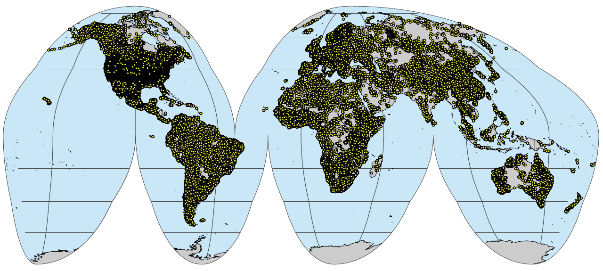

# Public inventory of soil samples and soil profiles

Publicly managed collection of documented soil datasets (points) available for 
research and application without restrictions. These are eventually imported and 
bind to single GeoPackage file via [the OpenLandMap](https://opengeohub.org/about-openlandmap/) repository.

To cite this book please use:

- Hengl, T., Gupta, S., and others, (2025). [**An Open Compendium of Soil Datasets: Soil Observations and Measurements**](https://soildb.openlandmap.org). OpenGeoHub foundation, Wageningen, the Netherlands, <https://soildb.OpenLandMap.org/>, DOI: <https://doi.org/10.5281/zenodo.4748499>.

<a rel="license" href="https://zenodo.org/doi/10.5281/zenodo.4748499"></a><br />

To cite these maps please use:

```
@dataset{hengl_2025_soildb,
  author       = {Hengl, T. and Gupta, S.},
  title        = {{An Open Compendium of Soil Datasets: Soil Observations and Measurements}},
  year         = 2025,
  publisher    = {OpenGeoHub foundation},
  address      = {Wageningen},
  version      = {v0.2},
  doi          = {10.5281/zenodo.4748499},
  url          = {https://doi.org/10.5281/zenodo.4748499}
}
```

Peer-reviewed publication explaining all processing steps:

```
@Article{essd-18-989-2026,
AUTHOR = {Hengl, T. and Consoli, D. and Tian, X. and Nauman, T. W. and Nussbaum, M. and Isik, M. S. and Parente, L. and Ho, Y.-F. and Simoes, R. and Gupta, S. and Samuel-Rosa, A. and Zborowski Horst, T. and Safanelli, J. L. and Harris, N.},
TITLE = {OpenLandMap-soildb: global soil information at 30m spatial resolution for 2000--2022$+$ based on spatiotemporal Machine Learning and harmonized legacy soil samples and observations},
JOURNAL = {Earth System Science Data},
VOLUME = {18},
YEAR = {2026},
NUMBER = {2},
PAGES = {989--1036},
URL = {https://essd.copernicus.org/articles/18/989/2026/},
DOI = {10.5194/essd-18-989-2026}
}
```

To visualize global predictions of dynamic soil properties use: <https://world.soils.app>

To download the most up-to-date snapshot of all publicly available soil points 
bind and compiled as GeoPKG, please visit: [https://github.com/openlandmap/SoilSamples/](https://github.com/openlandmap/SoilSamples/tree/main/out).



## Contributing

Please feel free to contribute datasets by using [pull requests](https://docs.github.com/en/github/collaborating-with-issues-and-pull-requests/creating-a-pull-request).

For a list of books still to be added, see the [Issues](https://github.com/oscarbaruffa/BigBookofR/issues). 

All datasets are welcome, however, not well documented, incomplete and duplicate 
datasets might be removed.

The format for adding bibliography entries is:

**\#\# [Name of the dataset]**

**[Brief description of the dataset]**

**Note: mention the data licenses and if there the use is restricted in any way** 

**[Publication / how to cite]**

**[Project] - link to project homepage / blog**

**[Unique locations] - number of unique spatial locations**


If you have an addition or correction, make changes to the Rmd's and make pull-request.

Ideally, all datasets including various versions should come with a DOI. 
Don't have a DOI yet, please upload and register your dataset via <https://zenodo.org> or 
similar.

Commercial datasets can be also listed, however promotional materials, commercial offers 
and similar will be removed.
